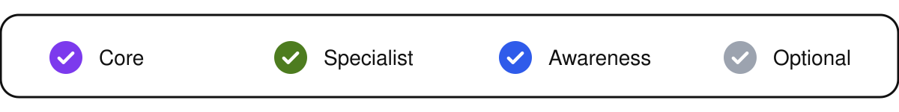

# Oracle EBS Developer Technology Landscape

**Baseline: Oracle E-Business Suite R12.2 · Reviewed: 27 October 2026**

This reference lists what an EBS developer needs to know, in two parts:

- **Technologies & Tools:** products and languages that EBS runs on or is built with, such as Oracle Database, PL/SQL, Oracle Forms and Java, and the tools used to build, test, migrate and diagnose with them.
- **Application components:** the parts of EBS itself, such as AOL, Workflow, public APIs and Publisher.

Every row has a **level**, which is the last column of each table. The rows are ordered by level: Core, Specialist, Awareness, then Optional.

| Level | Meaning | You can | Example |
| :--- | :--- | :--- | :--- |
|  **Core** | Breadth: the EBS developer foundation, including build, test and release. Every developer needs it. | Do the work without help. When more than one approach is valid, explain the choice you made and the alternative you rejected. | Call a public API with the right application context and handle its message stack. Write a PL/SQL package that sets the WHO columns and handles its exceptions. |
|  **Specialist** | Depth: expertise in one track (Report, Forms, OAF, Integration, Workflow, Data Migration & Upload, or APEX), listed in the tracks table below. | Design, build, test and troubleshoot a deliverable of the track. | Build an OAF page, a Publisher template or a workflow process. |
|  **Awareness** | Some knowledge of another subject area, such as functional, DBA or infrastructure. The work itself belongs to that team. | Read the results, name the terms, and name the team to ask and the evidence to bring. | Functional: explain which setup controls what an HCM Self-Service page shows. DBA: read an `adop` log and name the phase that failed. Infrastructure: read a certificate error and name the host. |
|  **Optional** | An additional platform or tool that the team selects. EBS works without it, and an example tool in this document is not a requirement to buy or install it. | Work at the depth of its capability once the project selects it. | Run a SonarQube scan and act on its findings. |

Specialist includes Core: a track is added to the Core foundation, and everything outside your track stays at Core, Awareness or Optional. Self-Service is a web page where an employee or a manager does their own task.

The Specialist tracks:

| # | Track Name | Technologies & components | Tools | APP Capability |
| --: | :--- | :--- | :--- | :--- |
| 1 | **Report** | Reporting & Document Generation, Discovery & Embedded Analytics | Report Builder, BI Publisher Template Builder for Word | Concurrent Programs, Request Sets, Value Sets, Output Post Processor (OPP), Bursting |
| 2 | **Forms** | Oracle Forms, Forms Personalization | Forms Builder | Menus and Functions, Flexfields, Message Dictionary, Profile Options, Attachments |
| 3 | **OAF** | Oracle Application Framework (OAF), OAF Personalization & Extensions | JDeveloper with OA Extension | Personalization Framework, Metadata Services (MDS), Function Security, Lookups, Profile Options |
| 4 | **Integration** | Integration & Services, Web Services & Messaging, Desktop Integration | SoapUI / Postman | Integrated SOA Gateway (ISG), Integration Repository, XML Gateway, Service Invocation Framework |
| 5 | **Workflow** | Workflow, Approvals & Business Events, Alerts & Event Automation | Oracle Workflow Builder | Business Event System (BES), Workflow Notifications, Alerts, Approvals Management (AME), Account Generator |
| 6 | **Data Migration & Upload** | Data Loading & Migration | FNDLOAD, WFLOAD, XDOLoader, JPXImporter, XMLImporter / XMLExporter | Open Interface Tables, Public APIs, Import Concurrent Programs, Lookups and Value Sets |
| 7 | **APEX** | Oracle APEX and Oracle REST Data Services (ORDS) | APEX App Builder, SQL Workshop | EBS authentication, Function Security, Public APIs, ORDS REST services |

In the tables, tool alternatives are separated by `/`, and a level applies to the area, not to every named product.

## Technologies & Tools

Products and languages that EBS runs on or is built with, and the tools used to build, test, migrate and diagnose with them.

| # | Area | Capability | Technology | Tools | Level |
| --: | :--- | :--- | :--- | :--- | :--- |
| T1 | Database | Oracle Database | Oracle SQL Oracle PL/SQL | Toad for Oracle / PL/SQL Developer / Oracle SQL Developer, SQL*Plus, SQLcl, SQL Trace, TKPROF, DBMS_XPLAN; Optional: SQL Monitor, DBMS_PROFILER, DBMS_HPROF |  Core |
| T2 | EBS Architecture & Runtime | EBS Platform & Release | Oracle HTTP Server (OHS) Oracle WebLogic Server Oracle Forms Services Edition-Based Redefinition (EBR) `adop` | Electronic Technical Reference Manual (eTRM), EBS Diagnostics, FND Logging, Concurrent Request Logs, Forms Trace, OAF Diagnostics |  Core |
| T3 | Data Formats & Transformation | Integration | XML JSON XSD XPath XSLT CSV | — |  Core |
| T4 | Scripting & Automation | EBS Platform & Release | Unix/Linux Shell Scripting SQL Scripts PL/SQL Scripts | — |  Core |
| T5 | Source Control & Release | Quality & Delivery | — | Git, CI/CD tooling selected by the team, Global Standards Compliance Checker (GSCC), Online Patching Database Standards Checker |  Core |
| T6 | Testing & Code Quality | Quality & Delivery | — | utPLSQL, JUnit |  Core |
| T7 | User Interface & Extensions | Forms | Forms | Forms Builder |  Specialist · Forms |
| T8 | User Interface & Extensions | OA Framework (OAF) | OA Framework (OAF) Java | JDeveloper with OA Extension |  Specialist · OAF |
| T9 | User Interface & Extensions | Extensions & Products | APEX | APEX App Builder, SQL Workshop |  Specialist · APEX |
| T10 | Reporting & Document Generation | Reporting | — | Oracle Reports Builder, BI Publisher Template Builder for Word |  Specialist · Report |
| T11 | Workflow & Business Events | Workflow | — | Oracle Workflow Builder |  Specialist · Workflow |
| T12 | Integration & Services | Integration | REST SOAP Oracle Advanced Queuing (AQ) EDI | Oracle Integration Repository, SoapUI / Postman |  Specialist · Integration |
| T13 | Data Loading & Migration | Data Migration & Upload | SQL*Loader `UTL_FILE` External Tables Oracle Data Pump | FNDLOAD, WFLOAD, XDOLoader, JPXImporter / XMLImporter, iSetup |  Specialist · Data Migration & Upload |
| T14 | DBA | DBA & Infrastructure | `adop` AD Administration AutoConfig WebLogic Administration Console AWR / ADDM | `adadmin`, `adautocfg.sh`, Rapid Clone, Oracle Enterprise Manager, WLST |  Awareness |
| T15 | Infrastructure | DBA & Infrastructure | Operating System Load Balancer SSL/TLS Certificates Firewalls | `top`, `vmstat`, `df`, `openssl`, `keytool`, `curl` |  Awareness |
| T16 | Integration & Services | Integration | Oracle Integration SOA Suite / BPEL | — |  Optional |
| T17 | Testing & Code Quality | Quality & Delivery | — | SonarQube |  Optional |
| T18 | Remote Access & File Transfer | EBS Platform & Release | — | PuTTY, WinSCP, command-line SFTP / SCP |  Optional |

## Application components

Parts of EBS itself: its modules, frameworks, APIs and features, with their own EBS rules and documentation.

| # | Area | Capability | Components | Level |
| --: | :--- | :--- | :--- | :--- |
| C1 | EBS Application Foundation | Oracle Database | **EBS Data Models & Organization Context:** APPS and product schemas, synonyms, table relationships, [WHO columns](https://docs.oracle.com/cd/E26401_01/doc.122/e22961/T302934T303920.htm), [Trading Community Architecture (TCA)](https://docs.oracle.com/cd/E26401_01/doc.122/e48950/T172155T172158.htm), ledgers, legal entities, operating units and inventory organizations, and the application and organization context of the business operation; see [Database Features](https://docs.oracle.com/cd/E26401_01/doc.122/e22949/T120505T120510.htm) and [Multiple Organizations](https://docs.oracle.com/cd/E26401_01/doc.122/e48833/T443823T443827.htm) |  Core |
| C2 | EBS Application Foundation | Application Object Library | **EBS Application Foundation:** Application Object Library (AOL/FND), Concurrent Processing, Flexfields, Value Sets, Lookups, Profile Options, Message Dictionary, Application Context, Attachments, System Administrator and User Management fundamentals; see [EBS Developer's Guide](https://docs.oracle.com/cd/E26401_01/doc.122/e22961/toc.htm) |  Core |
| C3 | Integration & Services | Data Migration & Upload | **Public APIs & Open Interfaces:** Documented product APIs, interface tables, import programs, application/organization context, validation, message stacks, transaction control and reconciliation; discover contracts through [Integration Repository](https://docs.oracle.com/cd/E26401_01/doc.122/e20927/toc.htm) and product API guides |  Core |
| C4 | Security & Access | Security | **Security & Access:** Responsibilities, Function Security, Data Security, Grants, Role-Based Access Control (RBAC), Oracle User Management (UMX), Multi-Org Access Control (MOAC), secure coding and credential handling; see [EBS Security Guide](https://docs.oracle.com/cd/E26401_01/doc.122/e22952/toc.htm) |  Core |
| C5 | User Interface & Extensions | Forms | **Forms Personalization:** Forms Personalization, `CUSTOM.pll` |  Specialist · Forms |
| C6 | User Interface & Extensions | OA Framework (OAF) | **OAF Personalization & Extensions:** [OAF Personalization](https://docs.oracle.com/cd/E26401_01/doc.122/e22031/toc.htm), supported extensions and substitutions |  Specialist · OAF |
| C7 | Reporting & Document Generation | Reporting | **Reporting & Document Generation:** Embedded BI Publisher / XML Publisher, XML data templates, Oracle Reports, RTF/PDF layouts, eText, XSL-FO, Bursting and Output Post Processor (OPP); see [R12.2 Publisher documentation access](https://docs.oracle.com/cd/E26401_01/doc.122/e22953/T174296T206856.htm), which directs readers to My Oracle Support note 1640073.1 for the Publisher guides |  Specialist · Report |
| C8 | Workflow & Business Events | Workflow | **Alerts & Event Automation:** [Oracle Alert](https://docs.oracle.com/cd/E26401_01/doc.122/e20930/toc.htm), periodic and event alerts, action sets |  Specialist · Workflow |
| C9 | Workflow & Business Events | Workflow | **Workflow, Approvals & Business Events:** [Oracle Workflow and Business Event System (BES)](https://docs.oracle.com/cd/E26401_01/doc.122/e22011/toc.htm), notifications, event subscriptions, Account Generator and [Approvals Management (AME)](https://docs.oracle.com/cd/E26401_01/doc.122/e59054/toc.htm) |  Specialist · Workflow |
| C10 | Integration & Services | Integration | **Integration & Services:** [Integrated SOA Gateway (ISG)](https://docs.oracle.com/cd/E26401_01/doc.122/e20927/toc.htm), Service Invocation Framework, [XML Gateway](https://docs.oracle.com/cd/E26401_01/doc.122/e20929/toc.htm) |  Specialist · Integration |
| C11 | Data Loading & Migration | Integration | **Desktop Integration:** Web Applications Desktop Integrator (Web ADI), [Desktop Integration Framework](https://docs.oracle.com/cd/E26401_01/doc.122/e22005/toc.htm), custom spreadsheet integrators and upload validation |  Specialist · Integration |
| C12 | Search & Analytics | Reporting | **Discovery & Embedded Analytics:** [Enterprise Command Centers (ECC)](https://docs.oracle.com/cd/E26401_01/doc.122/f21671/toc.htm), ECC Framework, data sets, full/incremental loads, dashboards and access rules; see also [Administering Enterprise Command Centers](https://docs.oracle.com/cd/E26401_01/doc.122/f34732.pdf) |  Specialist · Report |
| C13 | Functional Processes & Setup | Application Tracks | **Functional Processes & Setup:** Business processes of the application tracks in scope (Financials, Supply Chain, Human Resources), functional setups and configuration, responsibilities and menus, functional design documents and user acceptance testing; see the product user's and implementation guides |  Awareness |
| C14 | Product & Mobile | Extensions & Products | **Product & Mobile Specializations:** HRMS/Payroll [FastFormula](https://docs.oracle.com/cd/E26401_01/doc.122/e59058/toc.htm), supported product APIs/user hooks, [Subledger Accounting (SLA/XLA)](https://docs.oracle.com/cd/E26401_01/doc.122/e48771/index.html), Accounting Methods Builder and [EBS Mobile Foundation](https://docs.oracle.com/cd/E26401_01/doc.122/e69284/toc.htm), according to the modules in scope |  Optional |

## Design and documentation deliverables

Developers read these documents and write the parts that concern their own work. They are deliverables, not technologies, so they have no level.

| Document | Purpose |
| :--- | :--- |
| **MD050** | Functional design of the business requirement |
| **MD070** | Technical design of the extension |
| **MD120** | Build and conversion documentation |
| **Setup document** | Functional and technical setups needed to run the deliverable |
| **CEMLI inventory** | List of customizations, extensions, modifications, localizations and integrations, with technical review |
